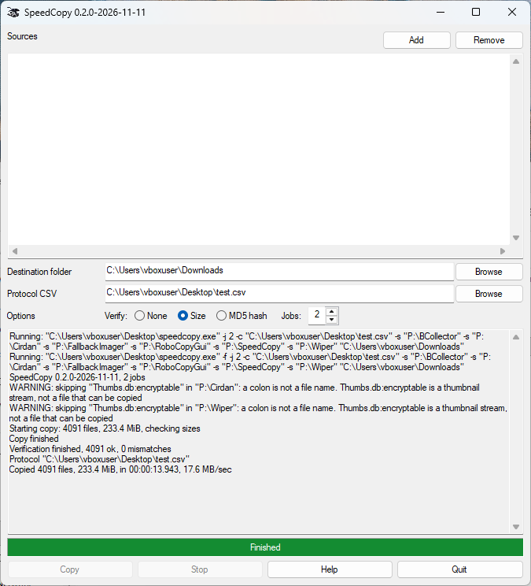

# SpeedCopy

Fast recursive copy for Windows 10/11 (64-bit). Size or MD5 checks run alongside the copy.



This is a one file standalone application - `speedcopy.exe` is all you need. No runtime DLLs to ship. With no arguments, a window opens. With arguments, it runs as a command-line tool.

## Features

- Copy files and folders into one destination directory or volume
- Each source is placed under its own name (`D:\photos` → `E:\backup\photos\...`)
- A drive root is placed directly (`D:\` → children of `E:\backup\`)
- No verification (`-n` / `--no-verify`), size check by default, or MD5 (`-m` / `-md5`)
- Checks run on other tasks during the copy. The copy does not wait on them
- Optional UTF-8 CSV protocol (`-c` / `--csv`)
- Parallel threads (`-j` / `--jobs`), at most one per CPU core. With no verification, at most 4 copy threads
- Keeps creation, access, and write times, plus ordinary attributes
- Junctions and symbolic links are skipped
- Long paths are supported

## Usage

```text
speedcopy.exe [-f|--force] [-n|--no-verify] [-m|-md5] [-j|--jobs N] [-c|--csv FILE] [-s|--source PATH]... <destination>
speedcopy.exe -h|--help
```

Example:

```text
speedcopy.exe -s D:\photos -s D:\notes.txt E:\backup
```

Paths use `\` between directories. The command line never asks a question: without `-f` / `--force`, it stops when existing files would be overwritten. The window asks before it replaces a file.

## Build

Requires MinGW-w64 (`x86_64-w64-mingw32-gcc`, `windres`).

```bash
./make-exe.sh
```

Release zip (`speedcopy.exe`, `README.md`, `LICENSE`):

```bash
./make-zip.sh
```

## License

MIT. See [LICENSE](LICENSE).

Author: Markus Thilo \<markus.thilo@proton.me\>
